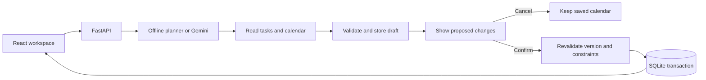

# FlowPilot

An approval-first day planner for the Alexa+ track of Build, Ship, Shape: Amazon Developer Hackathon. Plan a day, replan around interruptions, and review every task or calendar change before saving.

**Two included surfaces:** a Simulated Alexa+ Multimodal Web Experience (React, voice and text) and a Self-Hosted Streamable HTTP MCP Server at `/mcp` (protocol `2025-11-25`, alias `/api/v1/mcp`). Both use FastAPI, SQLite and the same validated tool registry. The [Agent Skill](skills/flowpilot-scheduler/SKILL.md) describes tool bindings and the approval workflow. Local MCP support is implemented; Amazon account onboarding and certification are separate deployment steps.

## Run locally on Windows PowerShell

Use Python 3.12+ and Node 20.19+ or 22.12+. This release was exercised on Windows with Python 3.14.6, Node 24.16.0 and npm 12.2.0.

From your checkout's root directory:

```powershell
python -m venv .venv
.\.venv\Scripts\python.exe -m pip install -r requirements-dev.txt
npm.cmd --prefix frontend ci
Copy-Item .env.example .env
npm.cmd --prefix frontend run build
.\.venv\Scripts\python.exe -m uvicorn server.main:app --host 127.0.0.1 --port 8000
```

Copy the example environment only when `.env` does not already exist; preserve your own configuration. Open **http://127.0.0.1:8000**. The built frontend and API run in one process. The browser creates an empty personal workspace; no sample tasks are added. Each selected date has its own saved tasks and calendar. Keep that terminal running; Ctrl+C stops it.

For frontend development, start the backend as above, then in a second PowerShell window run:

```powershell
npm.cmd --prefix frontend run dev -- --host localhost
```

Open http://localhost:5173. Vite proxies `/api` to port 8000. `npm.cmd` avoids execution-policy errors from the PowerShell npm wrapper. The root `npm.cmd run dev` starts both development servers using Python on PATH; activate your virtual environment first if using that shortcut.

## Try the working journey

1. Choose **Planning day**, **Today**, or the previous/next controls. The weekday is calculated from the date. New days start empty; existing demo sessions remain in SQLite and the previous browser session ID is preserved under `flowpilot_previous_demo_sid`.
2. Choose **Plan my day**. The setup asks for tasks and fixed events. Add your own task names, durations, priorities and optional deadlines. **Save task** saves only a task, without changing the calendar.
3. Choose **Preview my day** once there are pending tasks. Inspect the comparison. **Cancel** preserves the calendar; **Confirm plan** saves it. Finish review before changing days.
4. Choose **Add an interruption**. Enter its event name, start and end times, then **Preview fixed event**. Review any displaced work before confirming. No name or time is filled in automatically.
5. Choose **Fixed plan / routine**. Enter a routine name, select weekdays (for example Tuesday, Saturday and Sunday), and add one or more tasks with durations. Starting on the selected date, each matching day receives those tasks once when opened. Reopening or refreshing never duplicates them. Scheduling still requires a reviewed plan.
6. **Stop routine** prevents new occurrences and preserves already created tasks. A task removed from a particular day is not recreated by the routine. Days with a pending proposal defer routine generation until that proposal is resolved and the day is reopened.

The scheduler prefers **09:00-17:00**, with overflow up to **21:00** when needed and allowed by deadlines. It tries a full contiguous slot first. When that cannot fit, tasks longer than 60 minutes can span free gaps in chunks of at least 30 minutes, retaining the exact total duration. Tasks of 60 minutes or less stay contiguous. Fixed commitments and completed work stay protected. Personal days use the selected date at 09:00 as the planning origin. Routines populate once when matching dates are opened. Workspace IDs stay in this browser; tasks, routines and day mappings persist in SQLite.

The offline planner understands `Plan my day`, `What's left?`, explicit interruptions such as `Replan around Client Demo from 2:00 to 2:45 PM`, and `Remember: I prefer personal tasks in the afternoon`. Preferences are saved for the selected day and shown with a **Forget** control. Recognized morning work, afternoon personal, and explicit after-time preferences guide flexible placement; deadlines and fixed commitments take precedence. Other preference text is retained for the agent. Preferences are never fabricated from event titles. The expandable **Tool Execution Trace** shows tool arguments, results and durations in milliseconds after each turn.

See [the timed demo script](docs/DEMO_SCRIPT.md) for a recording walkthrough, including an optional protected client-meeting setup. The video must still be recorded and uploaded by the entrant.

## How approval works



The server validates overlaps, timezone-aware timestamps, full task allocations, task ownership, deadlines and protected events. Task edits invalidate earlier proposals. Confirmation uses the version captured when the proposal was reviewed. Repeat confirmation returns the existing result; transaction failures roll back domain changes. A failed live-provider attempt rolls back its draft work before fallback runs.

Diffs identify unchanged, moved, added, removed, shortened and lengthened blocks when applicable. The offline scheduler preserves full task durations and reports a recoverable error when work cannot fit; it does not silently shorten tasks. Removed task reservations return their task to pending status. Inferred preferences are not fabricated from event titles.

## Configuration and live mode

`.env` is loaded by the server. Environment variables override it. `.env` and local databases are gitignored.

| Variable | Default / purpose |
| --- | --- |
| `FLOWPILOT_DB_PATH` | `./data/flowpilot.db`; local SQLite file |
| `FLOWPILOT_DEFAULT_PROVIDER` | `deterministic`; optional `gemini` |
| `FLOWPILOT_GEMINI_MODEL` | `gemini-2.5-flash`; override with a model available to your key |
| `GEMINI_API_KEY` | Blank for offline use; never commit a real key |
| `FLOWPILOT_DEMO_TIMESTAMP` | Legacy seeded API demo clock; personal days use their selected date |
| `FLOWPILOT_LLM_TIMEOUT_S` | 30-second model-turn budget |
| `FLOWPILOT_CORS_ORIGINS` | `http://localhost:5173` |

`requirements.txt` includes the Gemini SDK and pinned runtime dependencies; `requirements-dev.txt` adds test tools. Configure your key and choose **Use Gemini**. The badge reports the provider that answered; outages or missing credentials use a labeled fallback. The provider supplies tasks, committed calendar, clock and preferences in the initial turn context, with one copy of tool schemas and a bounded total timeout.

For the tested API key, use `FLOWPILOT_GEMINI_MODEL=gemini-3.5-flash-lite`: live task drafting and read-tool inference passed with this override. Google returned HTTP 404 for the requested `gemini-2.5-flash` default because it is no longer available to new users. See [Google's model catalog](https://ai.google.dev/gemini-api/docs/models) and choose a model available to your account.

The live provider can read saved tasks, propose task additions/partial edits/removals, and propose calendar changes. Missing details can be supplied in a follow-up message. Task drafts are reviewed separately from scheduling and persist across refresh. Neither provider can commit changes directly.

**Speak to Gemini** uses browser Web Speech recognition, switches the selected planner to Gemini, and leaves an editable transcript. Enable **Send after speaking** to submit automatically after recognition ends. **Read replies aloud** uses browser speech synthesis for new replies only. Speech languages include English (India/US) and Hindi; availability depends on the browser's speech service. Microphone permission, localhost or HTTPS, and a compatible browser are needed. Unsupported browsers retain typed input. The browser's recognition service may process audio; FlowPilot sends text to Gemini. A missing key or provider outage produces a labeled deterministic fallback with limited commands. Domain validation refusals are reported directly and do not count as provider outages.

Microphone input cannot approve changes. Use visible confirmation controls after reviewing the draft. Typed or spoken planning with pending tasks reaches the active provider; empty days open guided setup. The project has no external calendar synchronization or background reminder service.

## Use the MCP server

The same local start command serves `http://127.0.0.1:8000/mcp`. In an MCP inspector, choose **Streamable HTTP** and this URL. `initialize` negotiates `2025-11-25`; retain its `Mcp-Session-Id` and send `notifications/initialized`. Subsequent requests use `MCP-Protocol-Version: 2025-11-25`. POST with `Content-Type: application/json` and `Accept: application/json, text/event-stream`. Responses use JSON; optional standalone GET streams and DELETE termination return 405. Invalid origins are rejected. See the [transport specification](https://modelcontextprotocol.io/specification/2025-11-25/basic/transports).

`tools/list` exposes five READ tools, three PROPOSE tools and `remember_preference`. `commit_schedule` is blocked. Example `tools/call` body:

```json
{"jsonrpc":"2.0","id":2,"method":"tools/call","params":{"name":"propose_task_changes","arguments":{"changes":[{"action":"add","title":"Prepare demo","duration_minutes":90}],"explanation":"Review this task before saving."}}}
```

Initialization creates an empty session. Bind an existing UI day with its session ID in `X-FlowPilot-Session-Id`, `Mcp-Session-Id`, or a tool's `session_id` argument. Conflicting selectors are rejected. Headerless inspector calls resolve a separate persistent default session. Tool results include the selected `session_id`.

Proposals return a `review_path`. Open it on the FlowPilot origin to inspect and confirm or cancel in the web UI. Task confirmation and calendar confirmation remain separate. `propose_schedule` with `blocks: []` runs the scheduler, including preferences. `propose_replan` accepts the full proposed calendar. Partial task updates preserve omitted fields; explicit `deadline: null` clears a deadline.

Preference storage is a separate safe tier: `remember_preference`, `POST /api/v1/sessions/{sid}/memory`, and `DELETE /api/v1/sessions/{sid}/memory/{mid}` only affect preference memory and versioning. They never mutate tasks or calendar blocks. Save a preference only on an explicit user request.

The local prototype uses session IDs without sign-in. Remote Alexa+ onboarding requires hosting and the authentication/account-linking steps in [Amazon's MCP guide](https://developer.amazon.com/docs/alexaplus/add-ons/mcp-toolkit-quickstart); those deployment steps are not included in this local release.

## Verify

With the virtual environment active (or substitute its full Python path):

```powershell
npm.cmd test
npm.cmd run smoke
npm.cmd --prefix frontend run build
npm.cmd run contract:check
```

See [release verification](docs/RELEASE_PROGRESS.md) for exact command results, live-model checks and browser coverage.

Unit/integration tests use isolated temporary databases. Real-provider tests are skipped unless you explicitly set `FLOWPILOT_RUN_LIVE_TESTS=1` and supply a key. There is no separate configured frontend lint command; the build includes `tsc --noEmit`.

Browser verification is optional and uses the installed Chrome browser:

```powershell
python -m pip install playwright
$env:FLOWPILOT_DB_PATH = './data/browser-check.db'
$env:FLOWPILOT_DEFAULT_PROVIDER = 'deterministic'
python -m uvicorn server.main:app --host 127.0.0.1 --port 8012
```

In another terminal, from the repository root:

```powershell
python scripts/browser_personal_days.py --url http://127.0.0.1:8012
```

The script creates its own session, checks real UI/API persistence and writes desktop/mobile screenshots under `data/personal-days/`. Those local screenshots are gitignored; regenerate them before sharing.

## Current limits

- One selected day with preferred 09:00-17:00 hours and a 21:00 ceiling for flexible work. Greedy placement may reject a day that requires rearranging previously placed tasks. No automatic multi-day planning or configurable work hours.
- Editing or removing a task already linked to the committed calendar is rejected; the UI exposes editing for pending tasks. There is no manual task-completion control yet.
- Offline parsing is intentionally narrow; use task controls for new tasks. Gemini supports reviewed task creation, partial edits and removals, including clarification follow-ups.
- Local prototype: a session identifier scopes access, but there is no sign-in or production authorization system. Public hosting needs a separate access/security review.
- Browser refresh restores the current session and pending reviews. After an intentional database clean slate, a missing workspace ID is replaced with an empty personal workspace. Deleting browser storage loses that pointer, not the database rows.
- Setup commands are documented and local start/build are verified. A fresh-machine Python dependency installation was not performed in this session.

## Release evidence and submission

[Gap audit](docs/RELEASE_GAP_AUDIT.md), [progress and verification](docs/RELEASE_PROGRESS.md), [demo script](docs/DEMO_SCRIPT.md), [Devpost draft/checklist](docs/DEVPOST_SUBMISSION.md). Older architecture/task-board documents remain historical context and may describe the superseded pinned timetable.

Review the [official event rules](https://amazonappdev2026.devpost.com/rules) personally. The intended primary track is the permitted simulated Alexa+ experience route. The entrant must supply an accessible repository, accurate English description and feedback, a public video shorter than three minutes, and complete Devpost's final submission action. The code was published to GitHub in the prior review checkpoint; video upload, deployment and Devpost submission remain entrant actions.

## License

[MIT](LICENSE).
