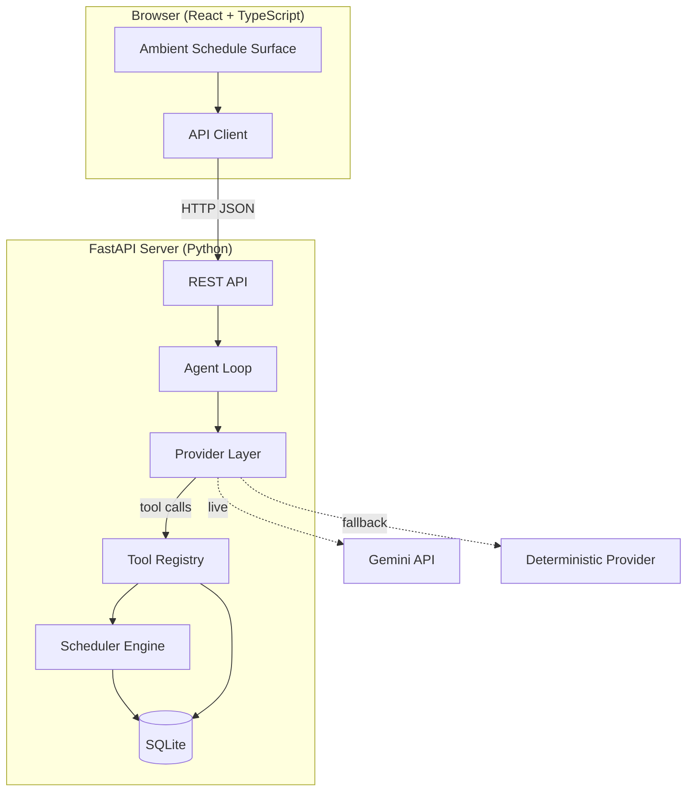

# FlowPilot

**Ambient AI scheduling agent that builds your time-block plan and replans instantly when life interrupts.**

> Built for [Build, Ship, Shape — Amazon Developer Hackathon 2026](https://devpost.com), Alexa+ Track.

## What it Does

FlowPilot turns a jumbled list of tasks, deadlines and calendar commitments into an optimised time-block schedule. When an interruption arrives — a meeting moves, a task overruns — FlowPilot replans around what you already completed. Completed work is always preserved. The diff shows what was kept, moved, shortened or dropped, and why. One click confirms the new plan.

## Architecture



## Quickstart

**Prerequisites:** Python 3.12+, Node 20+, Git

```powershell
# Clone
git clone <repo-url>
cd flowpilot

# Install Python dependencies
pip install -r requirements.txt

# Install frontend dependencies & build
cd frontend
npm install
npm run build
cd ..

# Copy environment config
Copy-Item .env.example .env
# Edit .env to add your GEMINI_API_KEY (optional — deterministic mode works without it)

# Start both services
npm run dev

# In another terminal, seed demo data
npm run seed

# Open http://localhost:5173 (dev) or http://localhost:8000 (single-process production mode)
```

## Modes

FlowPilot operates in two modes, always disclosed via a visible badge:

| Mode | Badge Text | Description |
|---|---|---|
| **Deterministic** | "Deterministic demo mode" | Rule-based provider. Uses real scheduling engine against real DB state. No LLM calls. Always available offline. |
| **Live** | "Live model (Gemini)" | Gemini API reasoning (`gemini-3.5-flash-lite`) using Google GenAI SDK with multi-tool execution. |
| **Fallback** | "Deterministic fallback" | Circuit breaker (2 failures → 60s cooldown) smoothly falls back to deterministic with `degraded: true`. |

The deterministic provider is never presented as autonomous AI reasoning. It executes the same real tools and produces valid schedules against real database state.

## Track Alignment (Alexa+)

This project uses **Approach B** (simulated Alexa+ experience) as its primary eligibility basis:

- **What is simulated:** The ambient voice-assistant surface. FlowPilot presents an Echo-Show-style visual interface with schedule management capabilities that would be natural on an Alexa+ device.
- **What is real:** All tool execution is real. The scheduling engine runs real constraint-based algorithms. State is persisted in SQLite. Plans are transactionally committed. The agent loop executes actual tool calls against actual database state.
- **MCP (if implemented):** P1 addition exposing the same tool registry over Streamable HTTP per MCP spec `2025-11-25`. Stated honestly in submission.

No production Alexa+ backend is used or claimed.

## Testing

```powershell
# Full test suite (130 tests passing)
npm test

# Golden smoke test (deterministic + live invariants + fallback)
npm run smoke

# Contract integrity check (OpenAPI schema vs frontend TypeScript types)
npm run contract:check

# Security tests (prompt injection, idempotency, stale plan rejection)
python -m pytest tests/test_injection.py tests/test_idempotency.py tests/test_stale_plan.py -v
```

## Project Structure

See [`docs/02_ARCHITECTURE.md`](docs/02_ARCHITECTURE.md) §12 for the full project tree.

## Documentation

| Document | Purpose |
|---|---|
| [`docs/00_PROJECT_CONTEXT.md`](docs/00_PROJECT_CONTEXT.md) | Entry point: facts, approach, doc index |
| [`docs/01_PRODUCT_SPEC.md`](docs/01_PRODUCT_SPEC.md) | Product spec, golden demo scenario |
| [`docs/02_ARCHITECTURE.md`](docs/02_ARCHITECTURE.md) | **Authoritative contract** |
| [`docs/03_MASTER_PLAN.md`](docs/03_MASTER_PLAN.md) | Schedule and milestones |
| [`docs/04_TASK_BOARD.md`](docs/04_TASK_BOARD.md) | Task board |

## License

[MIT](LICENSE)
