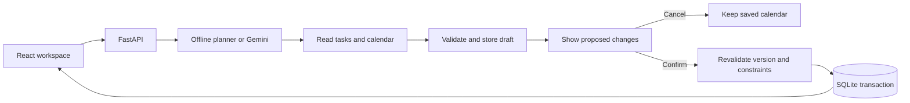

# FlowPilot

An Alexa+-inspired web simulation that plans a day, explains proposed changes, and waits for your approval before updating the calendar.

**Reproducible demo:** React + FastAPI + SQLite, with a clearly labeled offline planner. An optional Gemini tool-calling provider is available. No official Alexa+ integration, external calendar account, or AWS deployment is claimed.

## Run locally on Windows PowerShell

Use Python 3.12+ and Node 20.19+ or 22.12+. This release was exercised on Windows with Python 3.14.6, Node 24.16.0 and npm 12.2.0.

From your checkout's root directory:

```powershell
python -m venv .venv
.\.venv\Scripts\python.exe -m pip install -r requirements-dev.txt
npm.cmd --prefix frontend ci
Copy-Item .env.example .env
npm.cmd --prefix frontend run build
.\.venv\Scripts\python.exe -m uvicorn server.main:app --host 127.0.0.1 --port 8000
```

Copy the example environment only when `.env` does not already exist; preserve your own configuration. Open **http://127.0.0.1:8000**. The built frontend and API run in one process. The browser creates an empty personal workspace; no sample tasks are added. Each selected date has its own saved tasks and calendar. Keep that terminal running; Ctrl+C stops it.

For frontend development, start the backend as above, then in a second PowerShell window run:

```powershell
npm.cmd --prefix frontend run dev -- --host localhost
```

Open http://localhost:5173. Vite proxies `/api` to port 8000. `npm.cmd` avoids execution-policy errors from the PowerShell npm wrapper. The root `npm.cmd run dev` starts both development servers using Python on PATH; activate your virtual environment first if using that shortcut.

## Try the working journey

1. Choose **Planning day**, **Today**, or the previous/next controls. The weekday is calculated from the date. New days start empty; existing demo sessions remain in SQLite and the previous browser session ID is preserved under `flowpilot_previous_demo_sid`.
2. Choose **Plan my day**. The setup asks for tasks and fixed events. Add your own task names, durations, priorities and optional deadlines. **Save task** saves only a task, without changing the calendar.
3. Choose **Preview my day** once there are pending tasks. Inspect the comparison. **Cancel** preserves the calendar; **Confirm plan** saves it. Finish review before changing days.
4. Choose **Add an interruption**. Enter its event name, start and end times, then **Preview fixed event**. Review any displaced work before confirming. No name or time is filled in automatically.
5. Choose **Fixed plan / routine**. Enter a routine name, select weekdays (for example Tuesday, Saturday and Sunday), and add one or more tasks with durations. Starting on the selected date, each matching day receives those tasks once when opened. Reopening or refreshing never duplicates them. Scheduling still requires a reviewed plan.
6. **Stop routine** prevents new occurrences and preserves already created tasks. A task removed from a particular day is not recreated by the routine. Days with a pending proposal defer routine generation until that proposal is resolved and the day is reopened.

The current scheduler allocates within **09:00-17:00** in each day's displayed timezone. Personal days use the selected date at 09:00 as the planning origin, allowing deliberate whole-day planning, including historical days; this is not a real-time reminder service. The browser supplies the UTC offset for the chosen date. Routines populate when a matching day is opened; no background service or notifications are implied. Routine tasks have flexible times; use fixed events for exact time commitments. Workspace IDs are kept in this browser, while tasks, routines and day mappings persist in SQLite. There is no cross-device account system.

The offline planner understands a small documented command set. Use task controls for new task details; it will explain its limitations if given a free-form task paragraph. It supports explicit same-day interruption ranges or `at 2 PM for 30 minutes`, in the schedule's displayed timezone.

See [the timed demo script](docs/DEMO_SCRIPT.md) for a recording walkthrough, including an optional protected client-meeting setup. The video must still be recorded and uploaded by the entrant.

## How approval works



The server validates overlaps, timezone-aware timestamps, full task allocations, task ownership, deadlines and protected events. Task edits invalidate earlier proposals. Confirmation uses the version captured when the proposal was reviewed. Repeat confirmation returns the existing result; transaction failures roll back domain changes. A failed live-provider attempt rolls back its draft work before fallback runs.

Diffs identify unchanged, moved, added, removed, shortened and lengthened blocks when applicable. The offline scheduler preserves full task durations and reports a recoverable error when work cannot fit; it does not silently shorten tasks. Removed task reservations return their task to pending status. Inferred preferences are not fabricated from event titles.

## Configuration and live mode

`.env` is loaded by the server. Environment variables override it. `.env` and local databases are gitignored.

| Variable | Default / purpose |
| --- | --- |
| `FLOWPILOT_DB_PATH` | `./data/flowpilot.db`; local SQLite file |
| `FLOWPILOT_DEFAULT_PROVIDER` | `deterministic`; optional `gemini` |
| `GEMINI_API_KEY` | Blank for offline use; never commit a real key |
| `FLOWPILOT_DEMO_TIMESTAMP` | Legacy seeded API demo clock; personal days use their selected date |
| `FLOWPILOT_LLM_TIMEOUT_S` | 15-second model-turn budget |
| `FLOWPILOT_CORS_ORIGINS` | `http://localhost:5173` |

`requirements-dev.txt` includes the Gemini SDK and test tools. For an offline runtime alone, `requirements.txt` is sufficient. To try live inference, configure your key and choose **Use Gemini**. The badge reports the provider that actually answered; outages or missing credentials use a labeled fallback. Live API use may incur your provider's charges. Successful real Gemini inference was not verified in this release session; mocked tool-calling, failure and fallback paths were tested.

The live provider can reason over saved tasks and propose blocks. New tasks are entered through task controls in either mode. No voice input, MCP server, Alexa account connection, external calendar synchronization or cloud service is implemented.

## Verify

With the virtual environment active (or substitute its full Python path):

```powershell
npm.cmd test
npm.cmd run smoke
npm.cmd --prefix frontend run build
npm.cmd run contract:check
```

Unit/integration tests use isolated temporary databases. Real-provider tests are skipped unless you explicitly set `FLOWPILOT_RUN_LIVE_TESTS=1` and supply a key. There is no separate configured frontend lint command; the build includes `tsc --noEmit`.

Browser verification is optional and uses the installed Chrome browser:

```powershell
python -m pip install playwright
$env:FLOWPILOT_DB_PATH = './data/browser-check.db'
$env:FLOWPILOT_DEFAULT_PROVIDER = 'deterministic'
python -m uvicorn server.main:app --host 127.0.0.1 --port 8012
```

In another terminal, from the repository root:

```powershell
python scripts/browser_personal_days.py --url http://127.0.0.1:8012
```

The script creates its own session, checks real UI/API persistence and writes desktop/mobile screenshots under `data/browser-release/`. Those local screenshots are gitignored; regenerate them before sharing. Use `--channel msedge` if Edge is installed instead of Chrome.

## Current limits

- One day, fixed 09:00–17:00 work window; full contiguous tasks. Greedy placement may reject requests that require splitting or rearranging earlier work. No multi-day planning or configurable work hours.
- Editing or removing a task already linked to the committed calendar is rejected; the UI exposes editing for pending tasks. There is no manual task-completion control yet.
- Offline parsing is intentionally narrow. Free-form extraction of new tasks from a paragraph is unfinished. The live provider also has no task-creation tool.
- Local prototype: a session identifier scopes access, but there is no sign-in or production authorization system. Public hosting needs a separate access/security review.
- Browser refresh restores the current session and its locally remembered pending proposal. Deleting browser storage loses that pointer, not the database rows.
- Setup commands are documented and local start/build are verified. A fresh-machine Python dependency installation was not performed in this session.

## Release evidence and submission

[Gap audit](docs/RELEASE_GAP_AUDIT.md), [progress and verification](docs/RELEASE_PROGRESS.md), [demo script](docs/DEMO_SCRIPT.md), [Devpost draft/checklist](docs/DEVPOST_SUBMISSION.md). Older architecture/task-board documents remain historical context and may describe the superseded pinned timetable.

Review the [official event rules](https://amazonappdev2026.devpost.com/rules) personally. The intended primary track is the permitted simulated Alexa+ experience route. The entrant must supply an accessible repository, accurate English description and feedback, a public video shorter than three minutes, and complete Devpost's final submission action. No video upload, deployment, repository publication or Devpost submission was performed here.

## License

[MIT](LICENSE).
