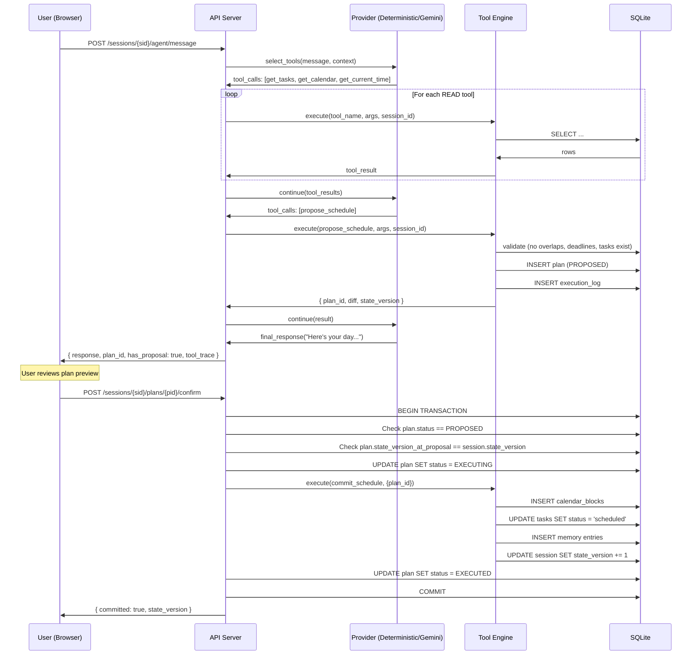

# FlowPilot — Architecture Contract

> **Authoritative contract.** All other documents reference this by section. No other document restates schemas, endpoints or tool definitions.

## 1. Component Boundaries

```
┌─────────────────────────────────────────────────┐
│  Browser (React + TypeScript, Vite build)       │
│  - Consumes generated API types only            │
│  - Dev: Vite proxy → localhost:8000             │
│  - Prod: static files served by FastAPI         │
└──────────────────┬──────────────────────────────┘
                   │ HTTP (JSON)
┌──────────────────▼──────────────────────────────┐
│  FastAPI Server (Python, single process)         │
│  ├─ REST API (§5)                               │
│  ├─ Agent Loop (§6)                             │
│  ├─ Tool Registry (§4)                          │
│  ├─ Provider Layer (§7)                         │
│  ├─ Scheduler Engine (deterministic, §6.3)      │
│  └─ SQLite via stdlib sqlite3 (§3)              │
│     └─ WAL mode, FK on, busy_timeout=5000       │
├─ Optional: MCP Endpoint (P1, §8)               │
└─────────────────────────────────────────────────┘
```

**Single-process, single-origin.** No microservices. Backend serves the built frontend at `/` and API at `/api/v1/`.

## 2. Configuration & Environment Variables

| Variable | Required | Description | Example |
|---|---|---|---|
| `FLOWPILOT_ENV` | no | `development` or `production` | `development` |
| `FLOWPILOT_PORT` | no | Server port | `8000` |
| `FLOWPILOT_DB_PATH` | no | SQLite file path | `./data/flowpilot.db` |
| `FLOWPILOT_CORS_ORIGINS` | no | Comma-separated allowed origins | `http://localhost:5173` |
| `GEMINI_API_KEY` | for live | Google Gemini API key | `AIzaSy_FAKE_KEY_EXAMPLE` |
| `FLOWPILOT_DEFAULT_PROVIDER` | no | `deterministic` or `gemini` | `deterministic` |
| `FLOWPILOT_LLM_TIMEOUT_S` | no | Live LLM call timeout in seconds | `15` |
| `FLOWPILOT_DEMO_TIMESTAMP` | no | ISO8601 override for injectable clock | `2026-10-22T09:00:00+05:30` |
| `FLOWPILOT_LOG_LEVEL` | no | Logging level | `INFO` |

## 3. SQLite Schema

All tables are session-scoped via `session_id` foreign key. Database is opened with `PRAGMA foreign_keys = ON; PRAGMA journal_mode = WAL; PRAGMA busy_timeout = 5000;`.

### 3.1 sessions

```sql
CREATE TABLE sessions (
  id TEXT PRIMARY KEY,              -- server-generated opaque token (uuid4)
  created_at TEXT NOT NULL,         -- ISO8601
  state_version INTEGER NOT NULL DEFAULT 1,
  demo_timestamp TEXT,              -- injectable clock override, ISO8601
  provider TEXT NOT NULL DEFAULT 'deterministic'  -- 'deterministic' | 'gemini'
);
```

### 3.2 tasks

```sql
CREATE TABLE tasks (
  id TEXT PRIMARY KEY,              -- e.g. "T1"
  session_id TEXT NOT NULL REFERENCES sessions(id) ON DELETE CASCADE,
  title TEXT NOT NULL,
  duration_minutes INTEGER NOT NULL CHECK(duration_minutes > 0),
  deadline TEXT,                    -- ISO8601 or NULL
  priority TEXT NOT NULL CHECK(priority IN ('HIGH','MEDIUM','LOW')),
  category TEXT NOT NULL CHECK(category IN ('work','personal','meeting')),
  status TEXT NOT NULL DEFAULT 'pending' CHECK(status IN ('pending','scheduled','completed','cancelled')),
  created_at TEXT NOT NULL
);
CREATE INDEX idx_tasks_session ON tasks(session_id);
```

### 3.3 calendar_blocks

```sql
CREATE TABLE calendar_blocks (
  id TEXT PRIMARY KEY,              -- uuid4
  session_id TEXT NOT NULL REFERENCES sessions(id) ON DELETE CASCADE,
  title TEXT NOT NULL,
  start_time TEXT NOT NULL,         -- ISO8601
  end_time TEXT NOT NULL,           -- ISO8601
  immutable INTEGER NOT NULL DEFAULT 0,  -- 1 = cannot be moved
  task_id TEXT REFERENCES tasks(id),
  status TEXT NOT NULL DEFAULT 'scheduled' CHECK(status IN ('scheduled','completed','cancelled')),
  plan_id TEXT REFERENCES plans(id),
  created_at TEXT NOT NULL
);
CREATE INDEX idx_calendar_session ON calendar_blocks(session_id);
CREATE INDEX idx_calendar_time ON calendar_blocks(session_id, start_time);
```

### 3.4 plans

```sql
CREATE TABLE plans (
  id TEXT PRIMARY KEY,              -- uuid4
  session_id TEXT NOT NULL REFERENCES sessions(id) ON DELETE CASCADE,
  status TEXT NOT NULL DEFAULT 'PROPOSED'
    CHECK(status IN ('PROPOSED','CONFIRMED','EXECUTING','EXECUTED','FAILED','CANCELLED','STALE')),
  proposed_blocks TEXT NOT NULL,    -- JSON array of proposed calendar block objects
  diff_summary TEXT,                -- JSON: { kept: [...], moved: [...], shortened: [...], dropped: [...] }
  explanation TEXT,                 -- agent's spoken explanation
  state_version_at_proposal INTEGER NOT NULL,  -- snapshot for stale detection
  provider_used TEXT NOT NULL,      -- 'deterministic' | 'gemini'
  degraded INTEGER NOT NULL DEFAULT 0,
  created_at TEXT NOT NULL,
  confirmed_at TEXT,
  executed_at TEXT
);
CREATE INDEX idx_plans_session ON plans(session_id);
```

### 3.5 execution_log

```sql
CREATE TABLE execution_log (
  id TEXT PRIMARY KEY,              -- uuid4
  session_id TEXT NOT NULL REFERENCES sessions(id) ON DELETE CASCADE,
  plan_id TEXT REFERENCES plans(id),
  tool_name TEXT NOT NULL,
  tool_args TEXT NOT NULL,          -- JSON
  tool_result TEXT NOT NULL,        -- JSON
  duration_ms INTEGER NOT NULL,
  created_at TEXT NOT NULL
);
CREATE INDEX idx_execlog_session ON execution_log(session_id);
CREATE INDEX idx_execlog_plan ON execution_log(plan_id);
```

### 3.6 memory

```sql
CREATE TABLE memory (
  id TEXT PRIMARY KEY,              -- uuid4
  session_id TEXT NOT NULL REFERENCES sessions(id) ON DELETE CASCADE,
  key TEXT NOT NULL,
  value TEXT NOT NULL,
  created_at TEXT NOT NULL
);
CREATE INDEX idx_memory_session ON memory(session_id);
CREATE UNIQUE INDEX idx_memory_key ON memory(session_id, key);
```

## 4. Tool Registry

All tools use MCP-shaped schemas (`name`, `description`, `inputSchema`). Tier controls mutation rules (§4.3 below).

| name | tier | description | inputSchema (JSON Schema) | return shape | side effects | validation |
|---|---|---|---|---|---|---|
| `get_tasks` | READ | List tasks for current session | `{ "type": "object", "properties": { "status": { "type": "string", "enum": ["pending","scheduled","completed","cancelled"] } }, "additionalProperties": false }` | `{ "tasks": Task[] }` | none | optional status filter |
| `get_calendar` | READ | Get calendar blocks for session | `{ "type": "object", "properties": { "date": { "type": "string", "format": "date" } }, "additionalProperties": false }` | `{ "blocks": CalendarBlock[] }` | none | optional date filter |
| `get_current_time` | READ | Get current time (injectable) | `{ "type": "object", "properties": {}, "additionalProperties": false }` | `{ "current_time": string, "timezone": string }` | none | none |
| `get_schedule` | READ | Get committed schedule | `{ "type": "object", "properties": {}, "additionalProperties": false }` | `{ "blocks": CalendarBlock[], "state_version": int }` | none | none |
| `get_memory` | READ | Retrieve stored memory entries | `{ "type": "object", "properties": {}, "additionalProperties": false }` | `{ "entries": MemoryEntry[] }` | none | none |
| `propose_schedule` | PROPOSE | Propose a new day schedule | `{ "type": "object", "properties": { "blocks": { "type": "array", "items": { "$ref": "#/CalendarBlockInput" } }, "explanation": { "type": "string", "maxLength": 500 } }, "required": ["blocks", "explanation"], "additionalProperties": false }` | `{ "plan_id": string, "diff": DiffSummary, "state_version": int }` | creates plan (PROPOSED), logs execution | blocks validated: no overlaps, within day, tasks exist, deadlines met |
| `propose_replan` | PROPOSE | Propose schedule changes after interruption | `{ "type": "object", "properties": { "new_blocks": { "type": "array", "items": { "$ref": "#/CalendarBlockInput" } }, "explanation": { "type": "string", "maxLength": 500 } }, "required": ["new_blocks", "explanation"], "additionalProperties": false }` | `{ "plan_id": string, "diff": DiffSummary, "state_version": int }` | creates plan (PROPOSED), completed blocks immutable, logs execution | completed blocks preserved, no overlaps |
| `commit_schedule` | COMMIT | Commit approved plan to schedule | `{ "type": "object", "properties": { "plan_id": { "type": "string" } }, "required": ["plan_id"], "additionalProperties": false }` | `{ "committed": bool, "state_version": int }` | atomically writes blocks, updates tasks, writes memory, increments state_version | plan must be PROPOSED, state_version must match |

### 4.1 CalendarBlockInput Schema

```json
{
  "type": "object",
  "properties": {
    "title": { "type": "string", "maxLength": 200 },
    "start_time": { "type": "string", "format": "date-time" },
    "end_time": { "type": "string", "format": "date-time" },
    "task_id": { "type": "string" },
    "immutable": { "type": "boolean", "default": false }
  },
  "required": ["title", "start_time", "end_time"]
}
```

### 4.2 DiffSummary Schema

```json
{
  "type": "object",
  "properties": {
    "kept": { "type": "array", "items": { "type": "object", "properties": { "block_id": {"type":"string"}, "title": {"type":"string"} } } },
    "moved": { "type": "array", "items": { "type": "object", "properties": { "block_id": {"type":"string"}, "title": {"type":"string"}, "old_start": {"type":"string"}, "new_start": {"type":"string"} } } },
    "shortened": { "type": "array", "items": { "type": "object", "properties": { "block_id": {"type":"string"}, "title": {"type":"string"}, "old_duration_min": {"type":"integer"}, "new_duration_min": {"type":"integer"} } } },
    "dropped": { "type": "array", "items": { "type": "object", "properties": { "block_id": {"type":"string"}, "title": {"type":"string"}, "reason": {"type":"string"} } } },
    "added": { "type": "array", "items": { "type": "object", "properties": { "title": {"type":"string"}, "start_time": {"type":"string"}, "end_time": {"type":"string"} } } }
  }
}
```

### 4.3 Tool Tier Rules

- **READ:** Never mutates any data. Called freely by the agent during planning.
- **PROPOSE:** May persist draft plans and execution log entries. Cannot change committed tasks, calendar blocks, or state_version. Domain-state versioning does not invalidate a stored proposal.
- **COMMIT:** Changes domain state (calendar blocks, task statuses, memory). Runs only via the `/api/v1/sessions/{sid}/plans/{pid}/confirm` endpoint. Confirmation is set by the human HTTP action, never by model output. Repeated confirm returns stored result without re-executing.

## 5. REST API Endpoints

Base: `/api/v1`

### Error Envelope (all errors)

```json
{
  "error": {
    "code": "STALE_PLAN",
    "message": "Plan state_version does not match current session state.",
    "details": {}
  }
}
```

### 5.1 Session Management

#### `POST /sessions`
Create a new session. Optionally seed with demo data.

**Request:**
```json
{ "seed": true, "demo_timestamp": "2026-10-22T09:00:00+05:30" }
```
**Response (201):**
```json
{ "session_id": "uuid", "state_version": 1, "provider": "deterministic", "seeded": true }
```

#### `DELETE /sessions/{sid}`
Reset session (re-seeds). Rate-limited: 1 per 5 seconds per session.

**Response (200):**
```json
{ "reset": true, "state_version": 1 }
```

### 5.2 Agent Interaction

#### `POST /sessions/{sid}/agent/message`
Send user utterance, trigger agent loop.

**Request:**
```json
{ "message": "Plan my day...", "state_version": 5 }
```
**Response (200):**
```json
{
  "response": "Here's your day...",
  "plan_id": "uuid-or-null",
  "has_proposal": true,
  "state_version": 5,
  "provider_used": "deterministic",
  "degraded": false,
  "tool_trace": [
    { "tool": "get_tasks", "args": {}, "result_summary": "5 tasks", "duration_ms": 12 }
  ]
}
```

### 5.3 Plan Lifecycle

#### `GET /sessions/{sid}/plans/{pid}`
Get plan details including proposed blocks and diff.

**Response (200):**
```json
{
  "plan_id": "uuid",
  "status": "PROPOSED",
  "proposed_blocks": [],
  "diff": { "kept": [], "moved": [], "shortened": [], "dropped": [], "added": [] },
  "explanation": "...",
  "state_version_at_proposal": 5,
  "provider_used": "deterministic",
  "degraded": false
}
```

#### `POST /sessions/{sid}/plans/{pid}/confirm`
Confirm and execute a proposed plan. **This is the human action that triggers COMMIT tools.**

**Request:**
```json
{ "state_version": 5 }
```
**Success (200):**
```json
{ "committed": true, "state_version": 6, "execution_log": [] }
```
**Stale (409):**
```json
{ "error": { "code": "STALE_PLAN", "message": "...", "details": { "expected": 5, "current": 6 } } }
```
**Already confirmed (200):**
```json
{ "committed": true, "state_version": 6, "already_executed": true }
```

#### `POST /sessions/{sid}/plans/{pid}/cancel`
Cancel a proposed plan.

**Response (200):**
```json
{ "cancelled": true, "state_version": 5 }
```

### 5.4 Data Retrieval

#### `GET /sessions/{sid}/schedule`
**Response (200):**
```json
{ "blocks": [], "state_version": 5 }
```

#### `GET /sessions/{sid}/tasks`
**Response (200):**
```json
{ "tasks": [], "state_version": 5 }
```

#### `GET /sessions/{sid}/memory`
**Response (200):**
```json
{ "entries": [], "state_version": 5 }
```

#### `GET /sessions/{sid}/execution-log`
**Response (200):**
```json
{ "entries": [] }
```

## 6. Agent Loop & State Machine

### 6.1 Plan State Machine

```
PROPOSED ──→ CONFIRMED ──→ EXECUTING ──→ EXECUTED
    │              │              │
    ▼              ▼              ▼
 CANCELLED      STALE         FAILED
```

**Transitions (idempotent):**
- `PROPOSED → CONFIRMED`: via confirm endpoint, only if `state_version` matches.
- `CONFIRMED → EXECUTING`: immediate, server-side, within the confirm transaction.
- `EXECUTING → EXECUTED`: all COMMIT tool steps succeed. `state_version` incremented.
- `EXECUTING → FAILED`: any COMMIT step fails. Rollback all domain mutations. Record failure in execution_log via separate transaction.
- `PROPOSED → CANCELLED`: via cancel endpoint.
- `PROPOSED → STALE`: automatic when `state_version` changes after proposal creation.

### 6.2 Agent Loop Sequence (Deterministic)



### 6.3 Interrupt & Replan Flow

Same as §6.2 but:
1. `get_schedule` returns committed blocks with their statuses.
2. Provider identifies completed blocks as immutable.
3. `propose_replan` validates completed blocks are preserved.
4. Diff shows kept/moved/shortened/dropped relative to current committed schedule.

### 6.4 Deterministic Provider

Rule-based, no LLM calls. Maps message patterns to tool sequences:
- "plan my day" → `[get_tasks, get_calendar, get_current_time] → propose_schedule`
- "replan" / interruption keywords → `[get_schedule, get_current_time] → propose_replan`
- "what's left" / status queries → `[get_schedule] → text response`

Scheduling logic is in the Scheduler Engine (deterministic code), not the provider. The provider only selects tools; the engine computes actual schedules. The deterministic provider outputs the exact golden-demo responses for the seeded scenario.

## 7. Provider Layer

### 7.1 Interface

```python
class Provider(Protocol):
    async def run_agent_turn(
        self, message: str, context: AgentContext
    ) -> AgentTurnResult: ...
```

`AgentContext` contains: session_id, conversation_history, available_tools, current_time.
`AgentTurnResult` contains: response_text, tool_calls_made, plan_id (if any), provider_used, degraded.

### 7.2 Gemini Provider

- Uses `google-genai` SDK (verify availability in early task).
- Model: `gemini-2.0-flash` (or latest available free-tier model).
- System prompt includes: tool schemas, session context, scheduling rules, memory entries. User content delimited as `<user_input>...</user_input>` (untrusted).
- Timeout: `FLOWPILOT_LLM_TIMEOUT_S` (default 15s).
- Retry: 1 retry on 5xx or timeout. No retry on 429.
- Malformed tool args: 1 repair attempt (feed back validation error).
- Circuit breaker: after 2 consecutive failures, skip live calls for 60s.
- Fallback: deterministic provider with `degraded: true`.

### 7.3 Offline Fixtures

Recorded provider responses for test harness. No network calls. Stored in `tests/fixtures/`.

## 8. MCP Server (P1)

If implemented, exposes the same tool registry (§4) over Streamable HTTP per MCP spec `2025-11-25`:
- Endpoint: `/mcp` (same FastAPI process)
- Exposes: READ and PROPOSE tools only
- COMMIT: only for plans already human-approved (confirmed via the REST API)
- Origin validation: localhost only
- Session: MCP session maps 1:1 to FlowPilot session via header

## 9. Security Model

Per §4.6 of the master prompt. Key points for implementation:

1. **API keys:** backend env only. `.env` gitignored. Browser never sees keys.
2. **Data:** all fictional demo data. No real PII.
3. **SQLite:** FK on, WAL, busy_timeout=5000, one transaction per commit, rollback on failure.
4. **Idempotent confirm:** atomic status guard. Repeat returns stored result.
5. **Stale-plan protection:** 409 if state_version mismatch.
6. **Input validation:** Pydantic models with length limits and enums on all endpoints.
7. **Tool allowlist:** only registered tools (§4) accepted. Schema validation on all tool args. IDs verified against caller's session.
8. **Session tokens:** server-generated uuid4. Per-session data isolation.
9. **Prompt injection:** user content in `<user_input>` delimiters. Injection test in fixtures.
10. **Rate limiting:** in-memory per-session, 10 agent messages per minute.
11. **CORS:** env allowlist, same-origin default, no wildcards.
12. **Reset:** session-scoped only. Global wipe is CLI-only. Rate-limited (1/5s).

## 10. Performance Budgets

| Target | How Measured | Value |
|---|---|---|
| Cold start (both services) | Time from `npm run dev` to first successful API call | ≤ 15s |
| Non-LLM API p95 | Measured in smoke test with 10 sequential requests | ≤ 200ms |
| Deterministic agent turn | Time for full message → response cycle | ≤ 1.5s |
| Live agent turn p95 | Measured over 5 live turns | ≤ 10s (hard timeout: 15s) |
| Provider-outage recovery | Time from failure to fallback response visible | ≤ timeout + 1s |
| Confirm action | User clicks | 1 click |
| Session reset + seed | API call duration | ≤ 2s |
| Clone to demo-ready | Time for clean clone + install + start | ≤ 10 min |
| Already-installed start | `npm run dev` to ready | ≤ 60s |
| Video | Recording duration | 150–170s |

## 11. Contract Integrity

### 11.1 OpenAPI Generation

FastAPI auto-generates OpenAPI schema from Pydantic models. Exported to `generated/openapi.json`.

### 11.2 Frontend Type Generation

`openapi-typescript` generates TypeScript types from `generated/openapi.json` into `frontend/src/api/types.ts`. Frontend code imports only from this generated file.

### 11.3 `contract:check` Command

```powershell
# In package.json scripts or as a standalone script
python server/export_openapi.py          # writes generated/openapi.json
npx openapi-typescript generated/openapi.json -o frontend/src/api/types.ts.check
git diff --no-index frontend/src/api/types.ts frontend/src/api/types.ts.check
# Exit 1 if diff is non-empty
```

### 11.4 Deviation Process

- **Class A (additive):** Edit `docs/02_ARCHITECTURE.md` → code → same commit → log in decisions.
- **Class B (breaking):** Edit `docs/02_ARCHITECTURE.md` + all dependent tasks → one commit → `contract:check` → log ADR. Cannot change P0 scope, track approach, or golden demo without Human + optional Opus audit.

## 12. Project Structure

```
flowpilot/
├── server/
│   ├── __init__.py
│   ├── main.py              # FastAPI app, CORS, static mount
│   ├── config.py             # Pydantic Settings from env
│   ├── database.py           # SQLite connection, migrations, seed
│   ├── models.py             # Pydantic request/response models
│   ├── routers/
│   │   ├── sessions.py       # Session CRUD
│   │   ├── agent.py          # Agent message endpoint
│   │   └── plans.py          # Plan confirm/cancel
│   ├── tools/
│   │   ├── registry.py       # Tool registry with MCP-shaped schemas
│   │   ├── read_tools.py     # get_tasks, get_calendar, get_current_time, get_schedule, get_memory
│   │   └── propose_tools.py  # propose_schedule, propose_replan
│   ├── providers/
│   │   ├── base.py           # Provider protocol
│   │   ├── deterministic.py  # Rule-based provider
│   │   ├── gemini.py         # Gemini provider
│   │   └── fallback.py       # Circuit breaker + fallback logic
│   ├── engine/
│   │   ├── scheduler.py      # Deterministic scheduling algorithms
│   │   ├── differ.py         # Schedule diff computation
│   │   └── validator.py      # Overlap, deadline, constraint validation
│   ├── clock.py              # Injectable clock
│   ├── seed.json             # Golden demo seed data
│   └── export_openapi.py     # Script to export OpenAPI JSON
├── frontend/
│   ├── src/
│   │   ├── api/
│   │   │   ├── types.ts      # Generated from OpenAPI (DO NOT EDIT)
│   │   │   └── client.ts     # API client using generated types
│   │   ├── components/
│   │   │   ├── UtteranceBar.tsx
│   │   │   ├── ResponseLine.tsx
│   │   │   ├── PlanPreview.tsx
│   │   │   ├── ScheduleTimeline.tsx
│   │   │   ├── ToolTrace.tsx
│   │   │   ├── ModeBadge.tsx
│   │   │   └── MemoryIndicator.tsx
│   │   ├── App.tsx
│   │   └── main.tsx
│   ├── index.html
│   ├── vite.config.ts
│   ├── tsconfig.json
│   └── package.json
├── generated/
│   └── openapi.json          # Generated (DO NOT EDIT)
├── tests/
│   ├── test_tools.py
│   ├── test_agent_loop.py
│   ├── test_golden_smoke.py
│   ├── test_injection.py
│   ├── test_idempotency.py
│   ├── test_stale_plan.py
│   └── fixtures/
│       └── offline_responses.json
├── scripts/
│   ├── check_docs.py         # Documentation validation
│   ├── dev.ps1               # Start dev servers
│   ├── seed.ps1              # Seed database
│   └── smoke.ps1             # Run golden smoke test
├── handoff/
│   └── .gitkeep
├── docs/                     # Planning documents
├── data/                     # SQLite files (gitignored)
├── .env.example
├── .gitignore
├── LICENSE
├── README.md
├── AGENTS.md
├── requirements.txt
└── package.json              # Root scripts (dev, test, contract:check)
```
